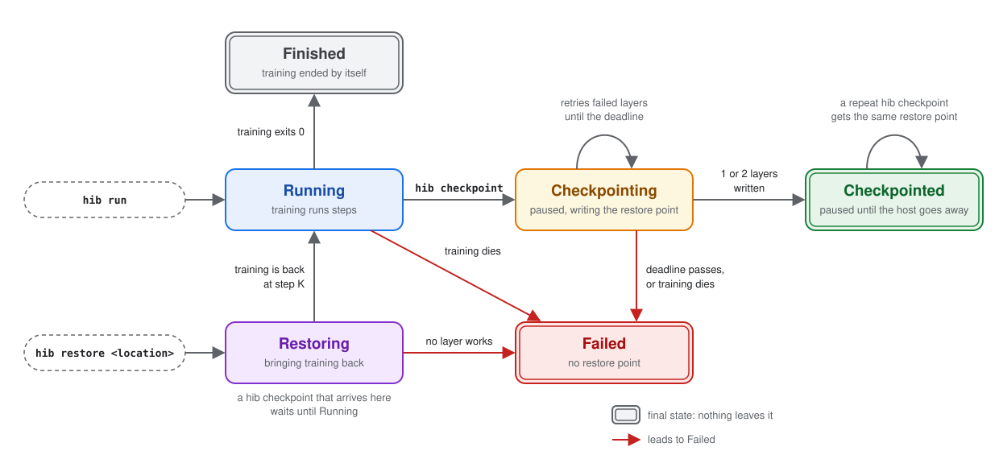

# Data shapes

Agreed on 2026-11-16: the workload states, the restore point manifest, the socket messages, and the exit codes.

## Workload states

The Supervisor is always in exactly one state. The state decides how the Supervisor answers every message.

### States

| State | Meaning | Training process |
|---|---|---|
| Restoring | `hib restore` is bringing the training process back on the restore host. | not running steps yet |
| Running | Training runs steps. | running |
| Checkpointing | A `hib checkpoint` request is in progress. The Supervisor waits for the next update boundary, then writes the restore point. It retries failed layers until the deadline. | paused at an update boundary |
| Checkpointed | Final. The Supervisor wrote a restore point with at least one layer. | paused until the host goes away |
| Finished | Final. Training ended by itself. | gone |
| Failed | Final. The workload ended on this host without finishing and without a restore point. | gone or stopped |

### Transitions



`fig/states.py` draws this figure. Run `python3 docs/design/fig/states.py docs/design/fig/states.svg` after you change it.

| From | To | Trigger |
|---|---|---|
| (start) | Running | `hib run` |
| (start) | Restoring | `hib restore <location>` |
| Restoring | Running | The training process is back at step K. It continues at K+1. |
| Restoring | Failed | Neither layer of the restore point works. |
| Running | Checkpointing | `hib checkpoint` arrives. |
| Running | Finished | The training process exits 0. |
| Running | Failed | The training process exits nonzero or dies. |
| Checkpointing | Checkpointed | At least one layer is written. |
| Checkpointing | Failed | The deadline arrives with no layer written, or both layers hit errors that a retry can't fix, or the training process dies. |

### How each state answers

| State | `hib checkpoint` arrives | Training hook reaches an update boundary | Training process exits |
|---|---|---|---|
| Restoring | Queue it. When Restoring ends in Running, start the checkpoint. When it ends in Failed, exit nonzero. The deadline counts from when the request arrived. | can't happen | Failed |
| Running | Start a checkpoint. Go to Checkpointing. | Reply "continue". | Exit 0: Finished. Otherwise: Failed. |
| Checkpointing | Join the checkpoint in progress and get the same answer. | Reply "pause". Write the restore point. | Failed |
| Checkpointed | Return the existing restore point. Exit 0. | can't happen, training is paused | expected when the host goes away |
| Finished | Exit nonzero: nothing to checkpoint. | can't happen | can't happen |
| Failed | Exit nonzero: no restore point. | can't happen | can't happen |

`hib status` reports the current state in every state.

### Rules

1. The Supervisor switches to Checkpointing before it starts any checkpoint work. A second `hib checkpoint` then sees Checkpointing and joins the first one.
2. The Supervisor owns the retries. The Disruption handler runs `hib checkpoint` once, with a deadline, and gets one final answer. The Supervisor gives up a few seconds before the deadline, so its answer arrives before the host goes away. It gives up at once on errors that a retry can't fix.
3. An exit code reports how one `hib checkpoint` went. A state reports where the Supervisor is now. They are separate.
4. In Checkpointed, training never resumes on the checkpoint host. Two copies of the workload never run at once.
5. The Supervisor stays alive after Checkpointed, so a repeated `hib checkpoint` gets the same restore point.
6. The Disruption handler passes the deadline with `--deadline`. It takes either a duration, such as `90s`, or a clock time, such as `2026-11-16T10:02:00Z`. Without the flag, the deadline is 90 seconds. This is a working choice and may change.


## Restore point manifest

A restore point is one folder in S3. It holds the process snapshot files, the application checkpoint files, and one small file, `manifest.json`. The manifest describes the rest of the folder. `hib restore` reads it before it touches anything else.

### Fields

```json
{
  "schema_version": 2,
  "workload": "demo",
  "step": 1200,
  "created_at": "2026-11-16T10:01:12Z",
  "fingerprint": {
    "gpu": "NVIDIA A10G", "driver": "550.54.15", "cuda": "12.4",
    "cudnn": "90100", "pytorch": "2.5.1", "kernel": "6.8.0-1015-aws"
  },
  "python": "/home/ubuntu/run/.venv/bin/python",
  "command": {
    "argv": ["python", "train.py", "--lr", "3e-4"],
    "cwd": "/home/ubuntu/run",
    "env": {"...": "..."}
  },
  "layers": {
    "process_snapshot": {
      "status": "failed",
      "error": "criu dump: unsupported file type",
      "files": []
    },
    "application_checkpoint": {
      "status": "ok",
      "error": null,
      "files": [
        {"path": "app/model.pt", "size": 123456789, "sha256": "..."}
      ]
    }
  }
}
```

| Field | Why `hib restore` needs it |
|---|---|
| `schema_version` | To read old and new manifests correctly after the format changes. |
| `workload`, `step` | To say what it brings back, and to check that training continues at `step` + 1. |
| `created_at` | For people and tools that pick between several restore points. |
| `fingerprint` | To refuse a restore host whose fingerprint doesn't match. A value the host lacks is `"none"`, such as the driver on a host without a GPU. |
| `python` | To collect the restore host's fingerprint with the same Python environment the training process uses. |
| `command` | To start a fresh training process when it falls back to the application checkpoint. |
| `layers` | To know which layers to try, and to skip a failed layer. `error` says why it failed. |
| `files` | To find each file, and to catch a missing or cut-short file before loading it. |

The model weights and optimizer state are not in the manifest. They are files of the application checkpoint, and the manifest lists them under `files`.

### Rules

1. The Supervisor writes the manifest last, after every other file finishes uploading. A folder with a manifest is a complete restore point.
2. `hib restore` refuses a folder without a manifest.
3. `hib restore` checks the size and checksum of each file before it uses that layer.
4. `hib restore` compares the restore host's fingerprint with `fingerprint`, and refuses on a mismatch.

### Fingerprint

One Python module, `hibernus.fingerprint`, collects the fingerprint on both hosts, so the two always come out in the same format.

1. On the checkpoint host, the training hook collects it when the training process starts, and sends it with its interpreter path in `initialize`. The Supervisor keeps both and writes them into every manifest. The values can't change while the training process runs, so the Supervisor never collects them again.
2. On the restore host, `hib restore` runs `<python> -m hibernus.fingerprint` before it starts anything. Every value must match exactly. On a mismatch, it lists each value that differs and exits 1.

The module reads the GPU model and driver version from the NVIDIA driver's files in `/proc/driver/nvidia`, not through CUDA, so it never starts CUDA in the training process. It reads the CUDA, cuDNN, and PyTorch versions from the installed PyTorch.

### First build

The fake checkpoint writes a stand-in application checkpoint: one file, `app/step.json`, that holds only the step. The process snapshot is `"status": "failed"` with the error `"not built yet"`. So the first build exercises the fallback path: `hib restore` starts a fresh training process from `command`, and that process reads the step from the file.

### Open questions

- `command.env` can hold secrets, such as cloud credentials, and the manifest sits in S3. Which variables does the Supervisor record? Until we decide, it records `{}`.

## Socket messages

Each Supervisor listens on one Unix socket, named after its workload, such as `/run/hib/<workload>.sock`. A message is one JSON object on one line, and every request gets one reply.

### Commands

`hib checkpoint` and `hib status` connect, send one request, print the reply, and exit. They pick the Supervisor with `--workload <name>`. The flag is optional when only one workload runs on the host.

| Command | Request | Reply |
|---|---|---|
| `hib checkpoint` | `{"op": "checkpoint", "deadline": "2026-11-16T10:02:00Z"}` | Success: `{"ok": true, "location": "s3://bucket/demo/step-1200-20261119T163000Z-3fa94c1e/", "manifest": {...}}`. Failure: `{"ok": false, "state": "Failed", "error": "..."}`. |
| `hib status` | `{"op": "status"}` | `{"state": "Running", "step": 1200, "location": null, "error": null}` |

`hib checkpoint` waits for the reply until the Supervisor reaches a final answer. The reply includes `location`, because the manifest doesn't say where it is stored, and the Launcher passes that location to `hib restore`.

### Training hook

The training hook keeps one connection open while it trains.

| When | Hook sends | Supervisor replies |
|---|---|---|
| The training process starts | `{"op": "initialize", "fingerprint": {...}, "python": "/path/to/python"}` | After `hib run`: `{"resume": null}`, so training starts at step 0. After a fallback restore: `{"resume": {"step": 1200, "files": [...]}}`, so the hook loads the files and training continues at step 1201. |
| Each update boundary | `{"op": "boundary", "step": 1200}` | `{"pause": false}` in Running. `{"pause": true, "dir": "..."}` in Checkpointing, where `dir` is the folder for the application checkpoint. A refusal in a final state, so training stops. |
| After `"pause": true` | `{"op": "app_checkpoint", "files": [...]}`, or `{"op": "app_checkpoint", "error": "..."}` if writing failed | No reply. The hook closes the connection and waits for SIGCONT, paused. |
| After a process snapshot restore | `{"op": "restored", "step": 1200, "fingerprint": {...}, "python": "/path/to/python"}` | `{"continue": true}`, so training continues at step 1201. A refusal if the step doesn't match the restore point. |

The hook keeps one connection open until it pauses. Then it closes the connection and waits for SIGCONT, so the Supervisor can stop it and run `criu dump`. After a process snapshot restore, the restore host's Supervisor sends SIGCONT, and the hook opens a new connection and sends `restored`. `restored` replaces `initialize` for a restored process, because the process wakes up past `initialize`. See [process-snapshot.md](process-snapshot.md).

A Supervisor that can't answer a message, such as one with an unknown `op`, replies `{"refused": "..."}`. The key differs from the `error` field of other replies, so a Failed status never reads as a refusal.

The hook always asks `initialize` instead of assuming step 0. A fresh training process knows nothing about the earlier run, and only the Supervisor has read the manifest.

## Exit codes

A Disruption handler sees only the number, so each code stands for a different action.

| Code | Meaning | What the Disruption handler does |
|---|---|---|
| 0 | The restore point is ready. | Passes the location to the Launcher. |
| 1 | No restore point: the checkpoint failed or training crashed. | Raises an alarm. The workload loses its progress. |
| 2 | Bad command, such as a missing flag. | A bug in the Disruption handler. Someone fixes it. |
| 3 | No Supervisor runs for that workload. | Probably a wrong name, or the workload already ended. |
| 4 | Training already finished. | Nothing. No progress was lost. |

`hib status` exits 0 whenever it gets an answer, even when the state is Failed. It exits 2 or 3 only when the command is wrong or it can't reach the Supervisor.

`hib restore` exits 1 when it refuses a restore point and 2 for a bad command. Otherwise it runs the training process like `hib run`, and exits with that process's exit code.

## First build

The first build proves the whole path with a fake checkpoint, on macOS, with a toy CPU loop. Everything is real except the checkpoint itself. It's built on a branch and reaches `main` only through a pull request.

| Step | What it adds | Check |
|---|---|---|
| 1 | A toy `train.py` loop that calls the training hook after each step. | It prints step numbers on its own. |
| 2 | `hib run`: the Supervisor, the socket, and the `initialize` and `boundary` messages. | `hib status` shows Running and the current step. |
| 3 | `hib checkpoint`: pause, the stand-in application checkpoint, and the manifest. | It exits 0 and prints the restore point location. Training stays paused. |
| 4 | `hib restore <location>`: the fallback path. | Training continues at step K+1. |

The Supervisor and the `hib` commands are written in Go, as one binary. The training hook is written in Python, because it runs inside `train.py`. The socket messages above are the only contract between the two languages, and the end-to-end check catches any drift between them.

The first build writes the restore point to a local folder instead of S3, so it needs no cloud setup. S3 comes later, as its own step. The folder is `~/.hib/restore-points/<workload>/step-<K>/`, and `--store` on `hib run` and `hib restore` changes the part before `<workload>`.

With `hib run --remote s3://<bucket>`, each checkpoint is also published to `s3://<bucket>/<workload>/step-<K>-<attempt>/`. The attempt is the UTC time the upload started plus random hex, such as `20261119T163000Z-3fa94c1e`. Stored files never change, and the IAM policy grants no delete, so an upload that was cut off leaves its files in place for good. Its own attempt folder keeps those files from blocking a later checkpoint at the same step. `hib restore s3://<bucket>/<workload>/` takes the highest step that has a complete manifest, and the latest attempt within that step. `hib run --remote` refuses a workload name that already has a complete restore point in the bucket, because the new run's restore points would mix with the old run's. Choose another `--workload`, or continue the old run with `hib restore`.

The Supervisor gives up on a checkpoint a tenth of the remaining time before the deadline, at most 5 seconds early. If the deadline arrives while a queued checkpoint waits in Restoring, only that request fails, and the restore goes on.

`make e2e` runs steps 1 to 4 end to end: it checkpoints the toy loop, stops it as if the checkpoint host went away, and restores it. It fails if training restarts at step 1.

Claude writes the code for each step and explains it. The user reviews each step and must understand it before the next one starts.
