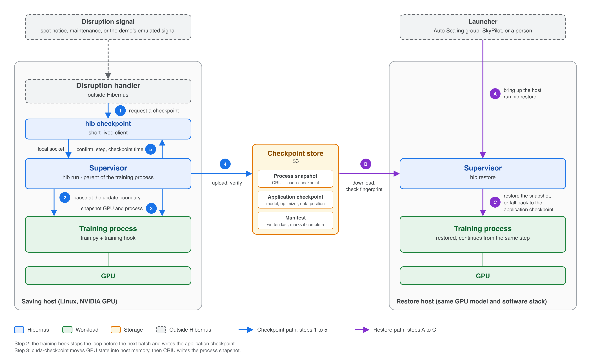
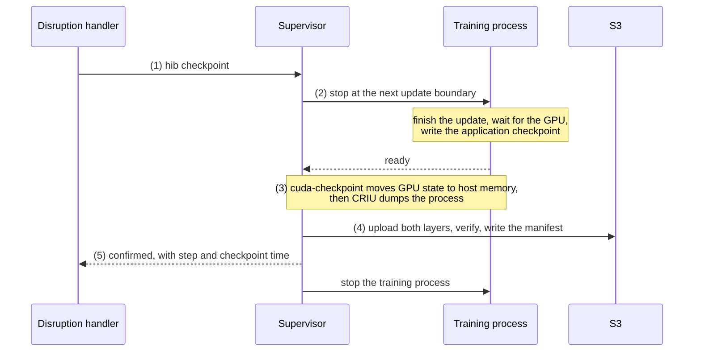
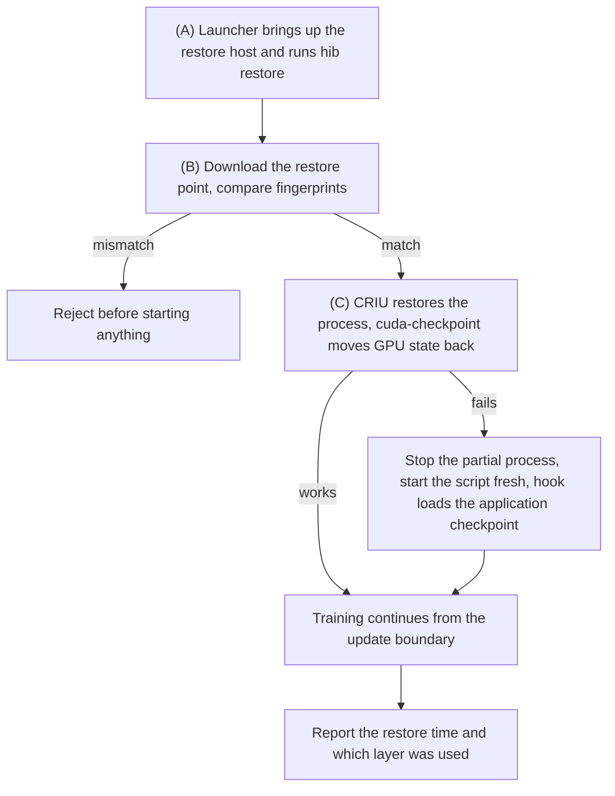
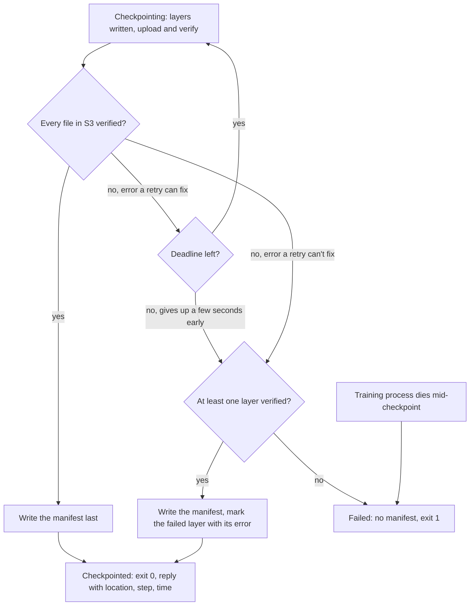

# Hibernus: system design

**Authors:** Krishna Mula, Nitish Kumar · **Status:** Draft · **Updated:** 2026-11-16 · **Reviewers:** TBD
**Earlier draft:** [Hibernus - System Design](https://docs.google.com/document/d/1T7q2CQmttRb6zzuQIegZUQr6KgYGLvYLDCJdH9m1qmM/edit)

## 1. Summary

Hibernus moves a PyTorch training workload on one GPU from one host to another. The restored workload continues as if it had never stopped.

- **Checkpoint.** On request, Hibernus pauses the workload at the next update boundary, captures it in two layers, and stores the restore point in S3.
- **Restore.** On a restore host with the same GPU model, Hibernus brings the workload back. It reads the same next batch and produces the same loss and parameters as a run that never stopped.
- **Outside Hibernus.** The disruption handler notices the disruption, and the launcher brings up the restore host. So the mechanism is the same for every kind of disruption.

*Figure 1. The checkpoint path (steps 1 to 5) and the restore path (steps A to C). Section 5 walks through each step.*

**Status:** No code exists yet. Nobody has measured anything in this doc on the target host, an EC2 G5 instance with an NVIDIA A10G.

### Terms

| Term | Meaning |
|---|---|
| **Workload** | One run of a program, from `hib run` until it finishes, that Hibernus keeps alive across disruptions. It is either a training workload or an inference workload. |
| **Training process** | The Linux process, with its DataLoader child processes, that runs a training workload on one host. The supervisor starts it as its child. |
| **Host** | A Linux computer with an NVIDIA GPU where Hibernus runs. |
| **Saving host** | The host where a checkpoint happens, because it is about to go away. |
| **Restore host** | The host where `hib restore` brings the workload back. |
| **Disruption** | An event that takes a host away from a workload, such as a spot reclaim or host maintenance. |
| **Update boundary** | The point in a training step after the optimizer, scheduler, and gradient reset finish, and before the next batch is read. Hibernus checkpoints only here. |
| **Checkpoint** | The act of capturing a workload at an update boundary and writing a restore point. A disruption handler starts one with `hib checkpoint`. |
| **Process snapshot** | The training process as the operating system sees it, including GPU memory. CRIU and `cuda-checkpoint` make it. |
| **Application checkpoint** | The state the training loop owns: the model, optimizer, scheduler, GradScaler, step counter, RNG states, and data position. |
| **Restore point** | The process snapshot and application checkpoint from one checkpoint, plus a manifest. A restore uses one restore point. |
| **Supervisor** | The long-running `hib` process for one workload on one host. It starts the training process as its child, and it checkpoints and restores that process on request. |
| **Training hook** | A small library inside the training process. It stops the loop at the update boundary and writes and loads the application checkpoint. |
| **Disruption handler** | The script or person on the workload's host that notices a disruption signal and runs `hib checkpoint`. Outside Hibernus. |
| **Launcher** | Whatever brings up the restore host and runs `hib restore` there, such as an Auto Scaling group, SkyPilot, or a person. Outside Hibernus. |
| **Fingerprint** | The GPU model and the driver, CUDA, cuDNN, PyTorch, and kernel versions of a host. |

## 2. Problem

### What goes wrong today

- **A stopped workload loses all its memory.** That includes everything on the GPU and in host RAM.
- **Periodic checkpoints cost compute.** A `torch.save` every N steps loses up to N steps of work.
- **Periodic checkpoints also miss state.** The epoch position, RNG states, and DataLoader prefetch state are easy to forget. Without them, the resumed workload reads different batches. The loss curve looks normal while the run silently repeats or skips data.
- **Common tools don't fix this.** Hugging Face `skip_first_batches` loses the shuffle buffer. `StatefulDataLoader` does not record each DataLoader process's RNG, so random augmentation diverges.

### Many disruptions give a warning

| Disruption | Warning |
|---|---|
| AWS reclaims a spot instance | 2 minutes |
| Cloud provider schedules host maintenance | Hours to days |
| A lab takes back a shared GPU | Whatever the lab gives |
| An end user moves a workload or reboots for an update | The end user decides |

In each case, something outside the workload knows the host is going away and can request a checkpoint. Two minutes can be too short for a final checkpoint (Cho et al., IEEE Access 2024), so the checkpoint time must be known in advance.

Failures with no warning, such as most hardware faults, are out of scope. See [prior-art.md](../research/prior-art.md) for how common they are.

### Who loses work

- Students and researchers on one spot GPU.
- Cloud GPU users who want to move a workload to cheaper capacity.
- Users of shared lab GPUs and workstations.

### What exists, and the gap

| Approach | Examples | Why it doesn't cover one GPU |
|---|---|---|
| Peer recovery | Gemini, torchft, SageMaker HyperPod, Bamboo, Oobleck | Recovers from replicas on other GPUs. One GPU has no peers. |
| Framework checkpointing | PyTorch DCP, Composer, Ray Train, NeMo, SageMaker managed spot | Leaves exact data resume to the user, or needs its own platform. |
| Relaunchers | SkyPilot | Brings up new capacity but carries no state. It could be the launcher. |
| Sidecar snapshots | DLRover Flash Checkpoint | Closest match, but built for its own cluster setup. |
| Process checkpointing | CRIU with `cuda-checkpoint`, CRIUgpu | Writes a local image only. No upload, no verification, no fallback. |

Details and sources are in [prior-art.md](../research/prior-art.md).

### What Hibernus adds

One installable tool that puts these pieces together for a single GPU on any Linux host: checkpoint on request, store off the host, verify, restore with a fallback, and report the checkpoint and restore times. The research contribution is small. The value is making the pieces work together reliably on hardware a student can rent.

## 3. Scope

### Goals

v1 targets one training workload on one NVIDIA GPU. The requirements in section 4 make each goal testable.

- Checkpoint a workload on request, at the next update boundary, to storage that outlives the host.
- Restore it on a restore host with the same GPU model and software stack.
- Resume exactly.
- Report checkpoint and restore times.
- Run on any Linux host with root access, not only on AWS.

### Non-goals

| Out of scope | Why |
|---|---|
| Detecting disruptions | The disruption handler does this, so Hibernus works the same for every disruption. The demo emulates a disruption signal. |
| Deciding when to checkpoint, or checkpointing periodically | Also the disruption handler's call. |
| Surviving a disruption with no checkpoint requested | Follows from the two rows above. The workload loses all progress since it started or was last restored. |
| Training on after a checkpoint | The workload stops once the supervisor confirms its checkpoint. Continuing would mean moving GPU state back into the same process, and nobody has shown that works yet. |
| Provisioning a GPU | The launcher does this. |
| Restoring on a different GPU model | A process snapshot needs the same GPU model. v1 uses one compatibility rule for both layers. |
| Checkpointing in the middle of an update | Needs an extra gradient buffer, and no mainstream system does it. |
| Multi-GPU and multi-host | DDP, FSDP, ZeRO, and NCCL state are too much for v1. |
| Datasets that change between checkpoint and restore | Exact resume needs the same data at the same path. |
| Open network connections inside the training process | CRIU cannot restore a remote socket. The supervisor holds the S3 connections instead. |

### Open scope questions

- **Inference workloads.** Does v1 cover batch inference too? A disrupted batch inference workload loses its in-flight items and pays its startup cost again.
- **DataLoader child processes.** Does v1 support `num_workers > 0`? If so, the process snapshot has to capture those processes.

## 4. Requirements

### Functional requirements

What the end user can do.

| ID | Requirement |
|---|---|
| F1 | Request a checkpoint. It happens at the next update boundary. |
| F2 | Given a restore point and a GPU, restore the workload on that GPU. |
| F3 | After a restore, the workload continues with the same next batch, loss, and parameters as a run that never stopped. |
| F4 | For each checkpoint and restore, see the checkpointed step, the checkpoint time (request to verified), and the restore time. |
| F5 | Opt in by prefixing the training command with `hib run`. |

### Non-functional requirements

How well Hibernus does it. Each row has a test.

| ID | Property | Requirement | Test |
|---|---|---|---|
| N1 | Consistency | A checkpoint captures only a completed update, never a partial one. | Request a checkpoint mid-accumulation. The restore point holds the last completed update. |
| N2 | Exactness | With deterministic mode on, a restored run matches a run that never stopped, bit for bit. | Compare the two runs. |
| N3 | Recoverability | If the process snapshot fails, the restore still succeeds from the application checkpoint. | Corrupt the process snapshot, then restore. |
| N4 | Durability | The supervisor confirms a checkpoint only after it verifies every file in S3. Hibernus never restores from a partial restore point. | Kill the workload mid-upload, then restore. |
| N5 | Compatibility | A restore works on any host with a matching fingerprint, and the supervisor rejects a mismatch before anything starts. | Restore on a second G5. Try a host with a different driver. |
| N6 | Speed | Hibernus reports checkpoint and restore times for every run. | Targets set after measuring on G5. |
| N7 | Idle overhead | With no checkpoint requested, `hib` adds under 1% to step time. | Compare step time with and without `hib`. |
| N8 | Resources | A checkpoint fails early with a clear error if the host lacks RAM (process plus GPU memory) or disk for the image. | Request a checkpoint on a host with too little disk. |
| N9 | Environment | Linux, root access, one NVIDIA GPU with driver 550 or newer. | Install on a fresh G5. |

## 5. Architecture

### Two layers per checkpoint

Every checkpoint captures both layers at the same update boundary.

| | Process snapshot | Application checkpoint |
|---|---|---|
| Captures | CPU memory, threads, open files, GPU memory | Model, optimizer, scheduler, GradScaler, step, RNG states, data position |
| Made by | `cuda-checkpoint` moves GPU state to host memory, then CRIU dumps the process | The training hook |
| Needs from training code | Nothing | A small hook |
| Restores on | Same GPU model and software stack | Same, by v1's rule (section 3) |
| Role | Default | Fallback if the snapshot fails |

### The `hib` commands

`hib` is one installed program. Each command starts its own process.

| Command | Who runs it | What it does |
|---|---|---|
| `hib run train.py` | The end user | Starts the supervisor, which starts the training process as its child. |
| `hib checkpoint` | The disruption handler | Sends a checkpoint request to the running supervisor over a local socket, waits for the confirmation, and exits. |
| `hib restore <location>` | The launcher, on the restore host | Starts a supervisor that downloads the restore point and brings the workload back. |

### Components

| Component | Runs | Does |
|---|---|---|
| Supervisor | On the workload's host, as root, as the parent of the training process | Pauses the training process, runs `cuda-checkpoint` and CRIU, uploads and verifies, confirms, and stops the training process. On restore, checks the fingerprint, restores, and falls back. Holds all S3 connections. |
| Training hook | Inside the training process | Tracks the step and data position, stops the loop at the update boundary, and writes and loads the application checkpoint. |
| Checkpoint store | S3 | Holds each restore point and its manifest. |

The supervisor is a separate process because the training process cannot freeze and dump itself. The launcher cannot run on the saving host, because that host is about to go away.

### Checkpoint path

Step numbers match Figure 1.

- **Step 2** waits for the GPU to finish its queued work, so the snapshot never holds a half-applied update.
- **Step 3** must follow step 2. `cuda-checkpoint` needs the process idle on the GPU.
- **Step 4** writes the manifest last. A restore point without a manifest is invisible to `hib restore`.

### Restore path

Step letters match Figure 1.

### Failure path

The checkpoint path and the restore path each have failure branches. The supervisor owns every retry. The disruption handler runs `hib checkpoint` once, with a deadline, and gets one final answer.

- **A half-finished upload is invisible.** The manifest is written last. A folder with no manifest is not a restore point, and `hib restore` refuses it (N4).
- **One bad layer doesn't fail the checkpoint.** If the process snapshot fails but the application checkpoint verifies, the manifest records `process_snapshot: failed` with the error. The state still becomes Checkpointed, and a restore uses the fallback (N3).
- **Failed is final.** The handler gets exit code 1 and raises an alarm. The workload loses the progress since it started or was last restored. The supervisor stays alive, so a repeated `hib checkpoint` gets the same answer.
- **Restore failures.** A manifest check, a size or checksum mismatch, or a fingerprint mismatch makes `hib restore` refuse before anything starts, with exit code 1. If CRIU fails, the supervisor stops the partial process and falls back to the application checkpoint. If that fails too, the workload goes to Failed.
- **Open question.** If only the process snapshot verifies and the application checkpoint failed, the checkpoint is Checkpointed but has no fallback. Decide whether v1 accepts that or treats it as Failed.

### What the restore host must provide

- A fingerprint that matches the saving host.
- The training code and dataset at the same paths, unchanged. CRIU reopens files by path.
- Credentials to read the restore point from S3.
